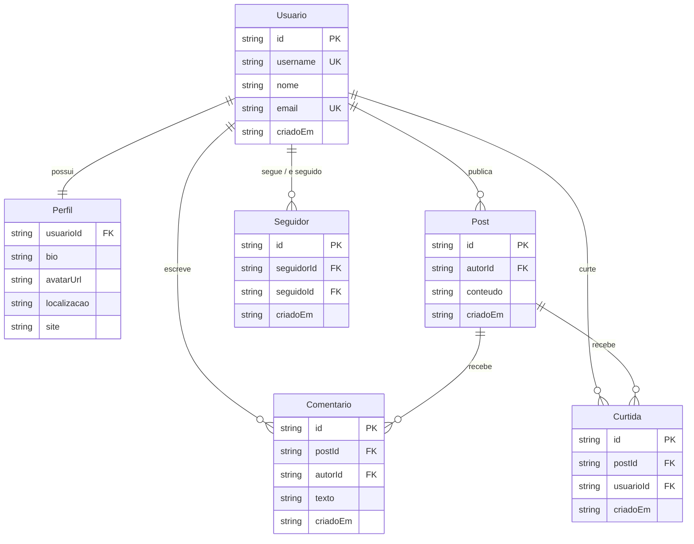
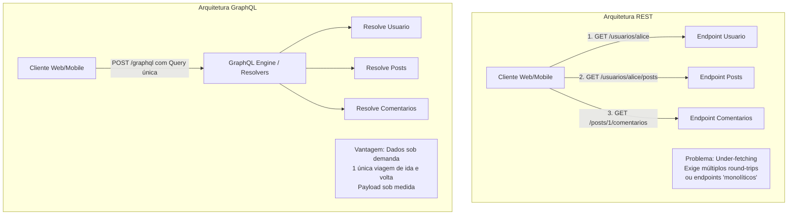

# Atividade 02 - Comparação Prática entre Protocolos de API: REST vs GraphQL

> **Disciplina:** APIs e Protocolos de Comunicação  
> **Domínio:** Rede Social Simplificada (`Usuario`, `Perfil`, `Post`, `Comentario`, `Curtida`, `Seguidor`)  
> **Protocolos Implementados:** **REST** e **GraphQL**  
> **Linguagem / Runtime:** Node.js (JavaScript ES Modules)  

---

## 1. Visão Geral do Projeto

Este projeto foi desenvolvido para atender aos requisitos da **Atividade 02**, cujo objetivo é **sentir na prática a diferença entre dois protocolos ao expor o mesmo domínio e saber quando cada um serve**.

Para isso, implementamos uma **Rede Social Simplificada** expondo as mesmas 6 entidades de domínio em dois dos protocolos mais importantes da arquitetura de software moderna:

1. **REST (Representational State Transfer):** Arquitetura orientada a recursos, verbos HTTP semânticos, múltiplos endpoints e códigos de status HTTP padrão.
2. **GraphQL:** Linguagem de consulta e manipulação em grafo, schema tipado (*SDL*), endpoint único (`/graphql`) e seleção granular de campos pelo cliente.

Ambos os protocolos compartilham a mesma camada de domínio e o mesmo banco de dados em memória (*in-memory store*). Isso significa que qualquer dado inserido via REST pode ser imediatamente consultado via GraphQL, e vice-versa.

---

## 2. Entidades do Domínio

O domínio modelado contém as 6 entidades solicitadas:



---

## 3. Instruções para Executar do Zero

### 3.1. Pré-requisitos
- **Node.js** (versão 18.x ou superior — recomendado LTS v20+ ou v24+).
- **npm** (incluso no instalador do Node.js).

> Se ainda não tiver o Node.js instalado no Windows, execute no terminal com privilégios de administrador:
> ```powershell
> winget install --id OpenJS.NodeJS.LTS
> ```

---

### 3.2. Passo a Passo de Execução

1. **Clone o repositório ou acesse a pasta do projeto:**
   ```bash
   cd rede-social-api-protocolos
   ```

2. **Instale as dependências:**
   ```bash
   npm install
   ```
   *(No Windows PowerShell, caso o script `npm.ps1` apresente restrição de execução, utilize `npm.cmd install` ou `node --version`)*.

3. **Inicie o servidor unificado:**
   ```bash
   npm start
   ```

4. **Acesse as interfaces no navegador:**
   - **Painel Geral:** [http://localhost:4000](http://localhost:4000)
   - **Índice da API REST:** [http://localhost:4000/api](http://localhost:4000/api)
   - **GraphiQL Playground Interativo:** [http://localhost:4000/graphql](http://localhost:4000/graphql)

---

### 3.3. Executando os Testes Automatizados

O projeto inclui suítes completas de testes automatizados que exercitam todos os **5 comandos** e todas as **5 consultas** em ambos os protocolos:

```bash
# Executa todos os testes (REST + GraphQL) de uma vez:
npm run test:all

# Ou teste individualmente cada protocolo:
npm run test:rest      # Apenas as 10 operações REST
npm run test:graphql   # Apenas as 10 operações GraphQL
```

---

## 4. Dados Iniciais de Teste (Seed Data)

Ao iniciar o servidor, o banco em memória é automaticamente alimentado com dados de exemplo:

- **Usuários:**
  - `usr-alice` (`username: "alice"`)
  - `usr-bob` (`username: "bob"`)
  - `usr-carlos` (`username: "carlos"`)
- **Posts:**
  - `post-1` (de `usr-alice`)
  - `post-2` (de `usr-bob`)
  - `post-3` (de `usr-alice`)
- **Conexões:**
  - Bob segue Alice
  - Carlos segue Alice
  - Alice segue Bob

---

## 5. Protocolo 1: REST

### 5.1. Resumo dos Endpoints REST

| Tipo | Operação Solicitada | Método HTTP | Rota | Descrição |
| :--- | :--- | :--- | :--- | :--- |
| **Comando** | `criar_usuario` | `POST` | `/api/usuarios` | Cria usuário e inicializa perfil |
| **Comando** | `criar_post` | `POST` | `/api/posts` | Publica um post para um usuário |
| **Comando** | `comentar` | `POST` | `/api/posts/:postId/comentarios` | Adiciona comentário a um post |
| **Comando** | `curtir` | `POST` | `/api/posts/:postId/curtidas` | Curte um post de forma idempotente |
| **Comando** | `seguir` | `POST` | `/api/usuarios/:usuarioId/seguir` | Segue o usuário identificado na rota |
| **Consulta** | `buscar_usuario` | `GET` | `/api/usuarios/:idOuUsername` | Retorna dados do usuário, perfil e contadores |
| **Consulta** | `posts_do_usuario` | `GET` | `/api/usuarios/:usuarioId/posts` | Lista todos os posts criados pelo usuário |
| **Consulta** | `buscar_post` | `GET` | `/api/posts/:postId` | Retorna post com autor, comentários e curtidas |
| **Consulta** | `seguidores_de / seguindo_de` | `GET` | `/api/usuarios/:usuarioId/conexoes` | Retorna quem o usuário segue e quem o segue |
| **Consulta** | `feed_do_usuario` | `GET` | `/api/usuarios/:usuarioId/feed` | Linha do tempo dos usuários seguidos + próprios posts |

---

### 5.2. Exemplos Copiáveis de Requisição e Resposta - REST

#### Comando 1: `criar_usuario`
**Requisição:**
```bash
curl -X POST http://localhost:4000/api/usuarios \
  -H "Content-Type: application/json" \
  -d '{
    "username": "danilo",
    "nome": "Danilo Costa",
    "email": "danilo@exemplo.com",
    "bio": "Engenheiro DevOps & Cloud",
    "localizacao": "Curitiba, PR",
    "site": "https://danilo.dev"
  }'
```
**Resposta (HTTP 201 Created):**
```json
{
  "sucesso": true,
  "mensagem": "Usuário criado com sucesso.",
  "dados": {
    "id": "7809a930-4e2a-4a62-bc2f-356191ef479e",
    "username": "danilo",
    "nome": "Danilo Costa",
    "email": "danilo@exemplo.com",
    "criadoEm": "2026-10-18T22:30:00.000Z",
    "perfil": {
      "usuarioId": "7809a930-4e2a-4a62-bc2f-356191ef479e",
      "bio": "Engenheiro DevOps & Cloud",
      "avatarUrl": "https://api.dicebear.com/7.x/bottts/svg?seed=danilo",
      "localizacao": "Curitiba, PR",
      "site": "https://danilo.dev"
    }
  }
}
```

---

#### Comando 2: `criar_post`
**Requisição:**
```bash
curl -X POST http://localhost:4000/api/posts \
  -H "Content-Type: application/json" \
  -d '{
    "autorId": "usr-alice",
    "conteudo": "Novo post testando a API REST na prática!"
  }'
```
**Resposta (HTTP 201 Created):**
```json
{
  "sucesso": true,
  "mensagem": "Post criado com sucesso.",
  "dados": {
    "id": "c1f19159-f815-4a66-ba39-84725350c37b",
    "autorId": "usr-alice",
    "conteudo": "Novo post testando a API REST na prática!",
    "criadoEm": "2026-10-18T22:30:01.000Z",
    "autor": {
      "id": "usr-alice",
      "username": "alice",
      "nome": "Alice Silva",
      "email": "alice@exemplo.com",
      "criadoEm": "2026-10-18T20:30:00.000Z"
    },
    "totalCurtidas": 0,
    "totalComentarios": 0
  }
}
```

---

#### Comando 3: `comentar`
**Requisição:**
```bash
curl -X POST http://localhost:4000/api/posts/post-1/comentarios \
  -H "Content-Type: application/json" \
  -d '{
    "autorId": "usr-bob",
    "texto": "Comentando via endpoint REST dedicado!"
  }'
```
**Resposta (HTTP 201 Created):**
```json
{
  "sucesso": true,
  "mensagem": "Comentário publicado com sucesso.",
  "dados": {
    "id": "d04e578c-0f9c-48be-8f15-385ee02fe559",
    "postId": "post-1",
    "autorId": "usr-bob",
    "texto": "Comentando via endpoint REST dedicado!",
    "criadoEm": "2026-10-18T22:30:02.000Z",
    "autor": {
      "id": "usr-bob",
      "username": "bob",
      "nome": "Bob Santos",
      "email": "bob@exemplo.com",
      "criadoEm": "2026-10-18T20:50:00.000Z"
    },
    "post": {
      "id": "post-1",
      "autorId": "usr-alice",
      "conteudo": "Explorando as diferenças práticas entre REST e GraphQL hoje na Atividade 02!",
      "criadoEm": "2026-10-18T21:30:00.000Z"
    }
  }
}
```

---

#### Comando 4: `curtir`
**Requisição:**
```bash
curl -X POST http://localhost:4000/api/posts/post-2/curtidas \
  -H "Content-Type: application/json" \
  -d '{
    "usuarioId": "usr-carlos"
  }'
```
**Resposta (HTTP 201 Created):**
```json
{
  "sucesso": true,
  "mensagem": "Post curtido com sucesso.",
  "dados": {
    "id": "6a9082b2-5f60-466d-a9ce-581ca69db001",
    "postId": "post-2",
    "usuarioId": "usr-carlos",
    "criadoEm": "2026-10-18T22:30:03.000Z",
    "jaExistia": false,
    "usuario": {
      "id": "usr-carlos",
      "username": "carlos",
      "nome": "Carlos Oliveira",
      "email": "carlos@exemplo.com"
    },
    "post": {
      "id": "post-2",
      "autorId": "usr-bob",
      "conteudo": "O problema do over-fetching é real. GraphQL resolve isso permitindo que o cliente escolha os campos."
    }
  }
}
```

---

#### Comando 5: `seguir`
**Requisição:**
```bash
curl -X POST http://localhost:4000/api/usuarios/usr-carlos/seguir \
  -H "Content-Type: application/json" \
  -d '{
    "seguidorId": "usr-bob"
  }'
```
**Resposta (HTTP 201 Created):**
```json
{
  "sucesso": true,
  "mensagem": "Usuário seguido com sucesso.",
  "dados": {
    "id": "87e35b71-10c8-47bc-a9d0-cb836371cb1f",
    "seguidorId": "usr-bob",
    "seguidoId": "usr-carlos",
    "criadoEm": "2026-10-18T22:30:04.000Z",
    "jaExistia": false,
    "seguidor": {
      "id": "usr-bob",
      "username": "bob",
      "nome": "Bob Santos"
    },
    "seguido": {
      "id": "usr-carlos",
      "username": "carlos",
      "nome": "Carlos Oliveira"
    }
  }
}
```

---

#### Consulta 1: `buscar_usuario`
**Requisição:**
```bash
curl -X GET http://localhost:4000/api/usuarios/usr-alice
```
**Resposta (HTTP 200 OK):**
```json
{
  "sucesso": true,
  "dados": {
    "id": "usr-alice",
    "username": "alice",
    "nome": "Alice Silva",
    "email": "alice@exemplo.com",
    "criadoEm": "2026-10-18T20:30:00.000Z",
    "perfil": {
      "usuarioId": "usr-alice",
      "bio": "Engenheira de Software apaixonada por arquiteturas distribuídas e APIs.",
      "avatarUrl": "https://api.dicebear.com/7.x/bottts/svg?seed=alice",
      "localizacao": "Natal, RN - Brasil",
      "site": "https://alice.dev"
    },
    "totalPosts": 2,
    "totalSeguidores": 2,
    "totalSeguindo": 1
  }
}
```

---

#### Consulta 2: `posts_do_usuario`
**Requisição:**
```bash
curl -X GET http://localhost:4000/api/usuarios/usr-alice/posts
```
**Resposta (HTTP 200 OK):**
```json
{
  "sucesso": true,
  "total": 2,
  "dados": [
    {
      "id": "post-3",
      "autorId": "usr-alice",
      "conteudo": "Mas não se esqueçam do cache HTTP nativo do REST com ETags e CDN!",
      "criadoEm": "2026-10-18T22:10:00.000Z",
      "autor": {
        "id": "usr-alice",
        "username": "alice",
        "nome": "Alice Silva",
        "email": "alice@exemplo.com",
        "perfil": {
          "bio": "Engenheira de Software apaixonada por arquiteturas distribuídas e APIs.",
          "localizacao": "Natal, RN - Brasil"
        }
      },
      "totalCurtidas": 0,
      "totalComentarios": 0
    },
    {
      "id": "post-1",
      "autorId": "usr-alice",
      "conteudo": "Explorando as diferenças práticas entre REST e GraphQL hoje na Atividade 02!",
      "criadoEm": "2026-10-18T21:30:00.000Z",
      "autor": {
        "id": "usr-alice",
        "username": "alice",
        "nome": "Alice Silva",
        "email": "alice@exemplo.com"
      },
      "totalCurtidas": 2,
      "totalComentarios": 2
    }
  ]
}
```

---

#### Consulta 3: `buscar_post`
**Requisição:**
```bash
curl -X GET http://localhost:4000/api/posts/post-1
```
**Resposta (HTTP 200 OK):**
```json
{
  "sucesso": true,
  "dados": {
    "id": "post-1",
    "autorId": "usr-alice",
    "conteudo": "Explorando as diferenças práticas entre REST e GraphQL hoje na Atividade 02!",
    "criadoEm": "2026-10-18T21:30:00.000Z",
    "autor": {
      "id": "usr-alice",
      "username": "alice",
      "nome": "Alice Silva",
      "perfil": {
        "bio": "Engenheira de Software apaixonada por arquiteturas distribuídas e APIs."
      }
    },
    "totalCurtidas": 2,
    "totalComentarios": 2,
    "comentarios": [
      {
        "id": "com-1",
        "postId": "post-1",
        "autorId": "usr-bob",
        "texto": "Sensacional, Alice! Essa comparação lado a lado deixa tudo muito claro.",
        "criadoEm": "2026-10-18T21:40:00.000Z",
        "autor": {
          "id": "usr-bob",
          "username": "bob",
          "nome": "Bob Santos"
        }
      },
      {
        "id": "com-2",
        "postId": "post-1",
        "autorId": "usr-carlos",
        "texto": "Concordo totalmente! Excelente domínio para o estudo de APIs.",
        "criadoEm": "2026-10-18T21:45:00.000Z",
        "autor": {
          "id": "usr-carlos",
          "username": "carlos",
          "nome": "Carlos Oliveira"
        }
      }
    ],
    "curtidas": [
      {
        "id": "curt-2",
        "postId": "post-1",
        "usuarioId": "usr-carlos",
        "usuario": {
          "id": "usr-carlos",
          "username": "carlos",
          "nome": "Carlos Oliveira"
        }
      },
      {
        "id": "curt-1",
        "postId": "post-1",
        "usuarioId": "usr-bob",
        "usuario": {
          "id": "usr-bob",
          "username": "bob",
          "nome": "Bob Santos"
        }
      }
    ]
  }
}
```

---

#### Consulta 4: `seguidores_de / seguindo_de`
**Requisição:**
```bash
curl -X GET http://localhost:4000/api/usuarios/usr-alice/conexoes
```
*(Também disponíveis separadamente em `/api/usuarios/usr-alice/seguidores` e `/api/usuarios/usr-alice/seguindo`)*

**Resposta (HTTP 200 OK):**
```json
{
  "sucesso": true,
  "dados": {
    "totalSeguidores": 2,
    "totalSeguindo": 1,
    "seguidores": [
      {
        "id": "usr-bob",
        "username": "bob",
        "nome": "Bob Santos",
        "desde": "2026-10-18T21:00:00.000Z"
      },
      {
        "id": "usr-carlos",
        "username": "carlos",
        "nome": "Carlos Oliveira",
        "desde": "2026-10-18T21:20:00.000Z"
      }
    ],
    "seguindo": [
      {
        "id": "usr-bob",
        "username": "bob",
        "nome": "Bob Santos",
        "desde": "2026-10-18T21:25:00.000Z"
      }
    ]
  }
}
```

---

#### Consulta 5: `feed_do_usuario`
**Requisição:**
```bash
curl -X GET "http://localhost:4000/api/usuarios/usr-bob/feed?limite=10"
```
**Resposta (HTTP 200 OK):**
```json
{
  "sucesso": true,
  "total": 3,
  "dados": [
    {
      "id": "post-3",
      "autorId": "usr-alice",
      "conteudo": "Mas não se esqueçam do cache HTTP nativo do REST com ETags e CDN!",
      "criadoEm": "2026-10-18T22:10:00.000Z",
      "autor": {
        "id": "usr-alice",
        "username": "alice",
        "nome": "Alice Silva"
      },
      "totalCurtidas": 0,
      "totalComentarios": 0,
      "comentarios": []
    },
    {
      "id": "post-2",
      "autorId": "usr-bob",
      "conteudo": "O problema do over-fetching é real. GraphQL resolve isso permitindo que o cliente escolha os campos.",
      "criadoEm": "2026-10-18T21:50:00.000Z",
      "autor": {
        "id": "usr-bob",
        "username": "bob",
        "nome": "Bob Santos"
      },
      "totalCurtidas": 1,
      "totalComentarios": 1,
      "comentarios": [
        {
          "id": "com-3",
          "texto": "Verdade, Bob. No mobile a economia de dados do GraphQL faz muita diferença.",
          "autor": {
            "username": "alice"
          }
        }
      ]
    },
    {
      "id": "post-1",
      "autorId": "usr-alice",
      "conteudo": "Explorando as diferenças práticas entre REST e GraphQL hoje na Atividade 02!",
      "criadoEm": "2026-10-18T21:30:00.000Z",
      "autor": {
        "id": "usr-alice",
        "username": "alice",
        "nome": "Alice Silva"
      },
      "totalCurtidas": 2,
      "totalComentarios": 2,
      "comentarios": [
        {
          "id": "com-1",
          "texto": "Sensacional, Alice! Essa comparação lado a lado deixa tudo muito claro.",
          "autor": {
            "username": "bob"
          }
        }
      ]
    }
  ]
}
```

---

## 6. Protocolo 2: GraphQL

### 6.1. Resumo das Operações GraphQL

No GraphQL, todas as operações trafegam via requisições `POST` para o endpoint único `http://localhost:4000/graphql`.
O cliente define no corpo da requisição um objeto com `{ "query": "...", "variables": { ... } }`.

| Tipo | Operação Solicitada | Campo no Schema | Tipo de Operação |
| :--- | :--- | :--- | :--- |
| **Comando** | `criar_usuario` | `criarUsuario(input: CriarUsuarioInput!): Usuario!` | Mutation |
| **Comando** | `criar_post` | `criarPost(input: CriarPostInput!): Post!` | Mutation |
| **Comando** | `comentar` | `comentar(input: ComentarInput!): Comentario!` | Mutation |
| **Comando** | `curtir` | `curtir(input: CurtirInput!): Curtida!` | Mutation |
| **Comando** | `seguir` | `seguir(input: SeguirInput!): RelacaoSeguidor!` | Mutation |
| **Consulta** | `buscar_usuario` | `buscarUsuario(idOuUsername: String!): Usuario` | Query |
| **Consulta** | `posts_do_usuario` | `postsDoUsuario(usuarioId: ID!): [Post!]!` | Query |
| **Consulta** | `buscar_post` | `buscarPost(id: ID!): Post` | Query |
| **Consulta** | `seguidores_de / seguindo_de` | `seguidoresDe(usuarioId: ID!)`, `seguindoDe(...)` | Query |
| **Consulta** | `feed_do_usuario` | `feedDoUsuario(usuarioId: ID!, limite: Int): [Post!]!` | Query |

---

### 6.2. Exemplos Copiáveis de Requisição e Resposta - GraphQL

> **Dica:** Você pode colar qualquer um dos blocos `mutation` ou `query` abaixo diretamente no **GraphiQL Playground** em [http://localhost:4000/graphql](http://localhost:4000/graphql) no seu navegador, ou executá-los via `curl`.

---

#### Comando 1: `criar_usuario`
**Requisição cURL:**
```bash
curl -X POST http://localhost:4000/graphql \
  -H "Content-Type: application/json" \
  -d '{
    "query": "mutation CriarUsuario($input: CriarUsuarioInput!) { criarUsuario(input: $input) { id username nome email perfil { bio localizacao } } }",
    "variables": {
      "input": {
        "username": "elena",
        "nome": "Elena Rostova",
        "email": "elena@exemplo.com",
        "bio": "Arquiteta de Software",
        "localizacao": "Belo Horizonte, MG"
      }
    }
  }'
```
**Resposta (HTTP 200 OK):**
```json
{
  "data": {
    "criarUsuario": {
      "id": "e838933b-814e-4f7f-859b-1ebdc7bf310b",
      "username": "elena",
      "nome": "Elena Rostova",
      "email": "elena@exemplo.com",
      "perfil": {
        "bio": "Arquiteta de Software",
        "localizacao": "Belo Horizonte, MG"
      }
    }
  }
}
```

---

#### Comando 2: `criar_post`
**Requisição cURL:**
```bash
curl -X POST http://localhost:4000/graphql \
  -H "Content-Type: application/json" \
  -d '{
    "query": "mutation CriarPost($input: CriarPostInput!) { criarPost(input: $input) { id conteudo criadoEm autor { id username } } }",
    "variables": {
      "input": {
        "autorId": "usr-alice",
        "conteudo": "Postando via Mutation do GraphQL com tipagem forte!"
      }
    }
  }'
```
**Resposta (HTTP 200 OK):**
```json
{
  "data": {
    "criarPost": {
      "id": "27c3eaeb-bfe6-4eb9-a41e-e28a5ff0c482",
      "conteudo": "Postando via Mutation do GraphQL com tipagem forte!",
      "criadoEm": "2026-10-18T22:30:10.000Z",
      "autor": {
        "id": "usr-alice",
        "username": "alice"
      }
    }
  }
}
```

---

#### Comando 3: `comentar`
**Requisição cURL:**
```bash
curl -X POST http://localhost:4000/graphql \
  -H "Content-Type: application/json" \
  -d '{
    "query": "mutation Comentar($input: ComentarInput!) { comentar(input: $input) { id texto criadoEm autor { username } post { id conteudo } } }",
    "variables": {
      "input": {
        "postId": "post-1",
        "autorId": "usr-carlos",
        "texto": "Comentário submetido via GraphQL!"
      }
    }
  }'
```
**Resposta (HTTP 200 OK):**
```json
{
  "data": {
    "comentar": {
      "id": "1809074b-e3bb-4ae3-9a5c-51fc434a9b40",
      "texto": "Comentário submetido via GraphQL!",
      "criadoEm": "2026-10-18T22:30:11.000Z",
      "autor": {
        "username": "carlos"
      },
      "post": {
        "id": "post-1",
        "conteudo": "Explorando as diferenças práticas entre REST e GraphQL hoje na Atividade 02!"
      }
    }
  }
}
```

---

#### Comando 4: `curtir`
**Requisição cURL:**
```bash
curl -X POST http://localhost:4000/graphql \
  -H "Content-Type: application/json" \
  -d '{
    "query": "mutation Curtir($input: CurtirInput!) { curtir(input: $input) { id criadoEm jaExistia usuario { username } post { id } } }",
    "variables": {
      "input": {
        "postId": "post-2",
        "usuarioId": "usr-alice"
      }
    }
  }'
```
**Resposta (HTTP 200 OK):**
```json
{
  "data": {
    "curtir": {
      "id": "curt-3",
      "criadoEm": "2026-10-18T21:55:00.000Z",
      "jaExistia": true,
      "usuario": {
        "username": "alice"
      },
      "post": {
        "id": "post-2"
      }
    }
  }
}
```

---

#### Comando 5: `seguir`
**Requisição cURL:**
```bash
curl -X POST http://localhost:4000/graphql \
  -H "Content-Type: application/json" \
  -d '{
    "query": "mutation Seguir($input: SeguirInput!) { seguir(input: $input) { id criadoEm jaExistia seguidor { username } seguido { username } } }",
    "variables": {
      "input": {
        "seguidorId": "usr-carlos",
        "seguidoId": "usr-bob"
      }
    }
  }'
```
**Resposta (HTTP 200 OK):**
```json
{
  "data": {
    "seguir": {
      "id": "1d8ce4a7-8f5b-4ec9-86f2-bf1aa4cb954a",
      "criadoEm": "2026-10-18T22:30:12.000Z",
      "jaExistia": false,
      "seguidor": {
        "username": "carlos"
      },
      "seguido": {
        "username": "bob"
      }
    }
  }
}
```

---

#### Consulta 1: `buscar_usuario`
*(Note como no GraphQL podemos pedir apenas os campos que o componente de UI precisa, economizando banda)*

**Requisição cURL:**
```bash
curl -X POST http://localhost:4000/graphql \
  -H "Content-Type: application/json" \
  -d '{
    "query": "query { buscarUsuario(idOuUsername: \"alice\") { id username nome email perfil { bio localizacao site } totalPosts totalSeguidores totalSeguindo } }"
  }'
```
**Resposta (HTTP 200 OK):**
```json
{
  "data": {
    "buscarUsuario": {
      "id": "usr-alice",
      "username": "alice",
      "nome": "Alice Silva",
      "email": "alice@exemplo.com",
      "perfil": {
        "bio": "Engenheira de Software apaixonada por arquiteturas distribuídas e APIs.",
        "localizacao": "Natal, RN - Brasil",
        "site": "https://alice.dev"
      },
      "totalPosts": 2,
      "totalSeguidores": 2,
      "totalSeguindo": 1
    }
  }
}
```

---

#### Consulta 2: `posts_do_usuario`
**Requisição cURL:**
```bash
curl -X POST http://localhost:4000/graphql \
  -H "Content-Type: application/json" \
  -d '{
    "query": "query PostsAlice($usuarioId: ID!) { postsDoUsuario(usuarioId: $usuarioId) { id conteudo criadoEm totalCurtidas totalComentarios } }",
    "variables": {
      "usuarioId": "usr-alice"
    }
  }'
```
**Resposta (HTTP 200 OK):**
```json
{
  "data": {
    "postsDoUsuario": [
      {
        "id": "post-3",
        "conteudo": "Mas não se esqueçam do cache HTTP nativo do REST com ETags e CDN!",
        "criadoEm": "2026-10-18T22:10:00.000Z",
        "totalCurtidas": 0,
        "totalComentarios": 0
      },
      {
        "id": "post-1",
        "conteudo": "Explorando as diferenças práticas entre REST e GraphQL hoje na Atividade 02!",
        "criadoEm": "2026-10-18T21:30:00.000Z",
        "totalCurtidas": 2,
        "totalComentarios": 2
      }
    ]
  }
}
```

---

#### Consulta 3: `buscar_post`
*(Demonstra a capacidade de fazer joins de entidades aninhadas em uma única requisição)*

**Requisição cURL:**
```bash
curl -X POST http://localhost:4000/graphql \
  -H "Content-Type: application/json" \
  -d '{
    "query": "query { buscarPost(id: \"post-1\") { id conteudo autor { nome username } comentarios { texto autor { nome } } curtidas { usuario { username } } totalCurtidas totalComentarios } }"
  }'
```
**Resposta (HTTP 200 OK):**
```json
{
  "data": {
    "buscarPost": {
      "id": "post-1",
      "conteudo": "Explorando as diferenças práticas entre REST e GraphQL hoje na Atividade 02!",
      "autor": {
        "nome": "Alice Silva",
        "username": "alice"
      },
      "comentarios": [
        {
          "texto": "Sensacional, Alice! Essa comparação lado a lado deixa tudo muito claro.",
          "autor": {
            "nome": "Bob Santos"
          }
        },
        {
          "texto": "Concordo totalmente! Excelente domínio para o estudo de APIs.",
          "autor": {
            "nome": "Carlos Oliveira"
          }
        }
      ],
      "curtidas": [
        {
          "usuario": {
            "username": "carlos"
          }
        },
        {
          "usuario": {
            "username": "bob"
          }
        }
      ],
      "totalCurtidas": 2,
      "totalComentarios": 2
    }
  }
}
```

---

#### Consulta 4: `seguidores_de / seguindo_de`
**Requisição cURL:**
```bash
curl -X POST http://localhost:4000/graphql \
  -H "Content-Type: application/json" \
  -d '{
    "query": "query Conexoes($usuarioId: ID!) { seguidores: seguidoresDe(usuarioId: $usuarioId) { username nome } seguindo: seguindoDe(usuarioId: $usuarioId) { username nome } }",
    "variables": {
      "usuarioId": "usr-alice"
    }
  }'
```
**Resposta (HTTP 200 OK):**
```json
{
  "data": {
    "seguidores": [
      {
        "username": "bob",
        "nome": "Bob Santos"
      },
      {
        "username": "carlos",
        "nome": "Carlos Oliveira"
      }
    ],
    "seguindo": [
      {
        "username": "bob",
        "nome": "Bob Santos"
      }
    ]
  }
}
```

---

#### Consulta 5: `feed_do_usuario`
**Requisição cURL:**
```bash
curl -X POST http://localhost:4000/graphql \
  -H "Content-Type: application/json" \
  -d '{
    "query": "query FeedBob($usuarioId: ID!) { feedDoUsuario(usuarioId: $usuarioId, limite: 5) { id conteudo autor { username } totalCurtidas comentarios { texto autor { username } } } }",
    "variables": {
      "usuarioId": "usr-bob"
    }
  }'
```
**Resposta (HTTP 200 OK):**
```json
{
  "data": {
    "feedDoUsuario": [
      {
        "id": "post-3",
        "conteudo": "Mas não se esqueçam do cache HTTP nativo do REST com ETags e CDN!",
        "autor": {
          "username": "alice"
        },
        "totalCurtidas": 0,
        "comentarios": []
      },
      {
        "id": "post-2",
        "conteudo": "O problema do over-fetching é real. GraphQL resolve isso permitindo que o cliente escolha os campos.",
        "autor": {
          "username": "bob"
        },
        "totalCurtidas": 1,
        "comentarios": [
          {
            "texto": "Verdade, Bob. No mobile a economia de dados do GraphQL faz muita diferença.",
            "autor": {
              "username": "alice"
            }
          }
        ]
      },
      {
        "id": "post-1",
        "conteudo": "Explorando as diferenças práticas entre REST e GraphQL hoje na Atividade 02!",
        "autor": {
          "username": "alice"
        },
        "totalCurtidas": 2,
        "comentarios": [
          {
            "texto": "Sensacional, Alice! Essa comparação lado a lado deixa tudo muito claro.",
            "autor": {
              "username": "bob"
            }
          }
        ]
      }
    ]
  }
}
```

---

## 7. Comparação Final: REST vs GraphQL

A implementação do mesmo domínio em ambos os protocolos evidenciou distinções arquiteturais, conceituais e práticas fundamentais:



### 7.1. Critérios de Comparação Detalhados

#### 1. Paradigma Arquitetural e Modelagem
- **REST:** Centrado em **Recursos** acessíveis via URIs hierárquicas (`/usuarios/:id`, `/posts/:id/comentarios`). O servidor dita a estrutura exata do que é retornado. A modelagem reflete o modelo de dados ou agregados de recursos.
- **GraphQL:** Centrado em um **Grafo de Entidades** definido por um Schema fortemente tipado (`type Usuario`, `type Post`). As entidades têm arestas (*resolvers*) que permitem ao cliente navegar pelas relações livremente.

#### 2. Over-fetching e Under-fetching
- **No REST:** 
  - *Over-fetching:* Ao consultar `GET /api/usuarios/usr-alice`, recebemos biografia, avatar, e-mail, data de criação e contadores, mesmo se a tela atual precisasse apenas do `nome` e do `avatarUrl`.
  - *Under-fetching:* Para montar um feed completo de rede social com post, autor e comentários em um design puramente RESTful, o cliente precisaria fazer chamadas sucessivas (`GET /feed` $\rightarrow$ `GET /usuarios/:id` $\rightarrow$ `GET /posts/:id/comentarios`), gerando o clássico problema de **$N+1$ requisições de rede**.
- **No GraphQL:** O cliente especifica exatamente os campos que deseja. Se a tela de perfil só precisa de `{ nome, avatarUrl }`, nada mais é transmitido pela rede. Elimina tanto o *over-fetching* quanto o *under-fetching*.

#### 3. Viagens de Rede (Round Trips) e Latência
- **REST:** Para agregar dados de múltiplas entidades (ex.: usuário + seguidores + últimos posts), o frontend ou executa 3 requisições HTTP paralelas/sequenciais, ou o backend é forçado a criar rotas customizadas ("BFF - Backend For Frontend"), o que quebra a pureza RESTful.
- **GraphQL:** Agrega qualquer quantidade de entidades relacionadas em uma única chamada HTTP POST. Em redes móveis de alta latência (3G/4G), essa redução de round trips resulta em ganhos visíveis de performance e fluidez para o usuário final.

#### 4. Cacheabilidade (Cache de Rede vs Cache de Cliente)
- **REST (Grande Vantagem):** Aproveita a infraestrutura nativa do protocolo HTTP (RFC 7234). Cada recurso possui uma URL única, permitindo o uso transparente de cabeçalhos como `Cache-Control`, `ETag`, `Last-Modified` e servidores proxy reversos / CDNs (Cloudflare, Fastly, Nginx).
- **GraphQL:** Como todas as requisições chegam via `POST` na mesma URL `/graphql`, o cache tradicional de CDN HTTP por URL é inviabilizado por padrão. O cacheamento precisa ser delegado a clientes especializados com normalização de grafo (ex.: Apollo Client InMemoryCache, Urql) ou extensões de *Persisted Queries* com GET.

#### 5. Tipagem, Contrato e Evolução de API
- **REST:** O contrato é implícito, a menos que ferramentas externas sejam adotadas (OpenAPI / Swagger). Mudanças estruturais de campos costumam exigir versionamento de URL (`/v1/usuarios`, `/v2/usuarios`).
- **GraphQL:** O contrato é nativo e mandatório através do **Schema SDL**. O servidor valida tipos em tempo de execução e o cliente conta com inteliSense e autocompletar automático. A evolução ocorre por depreciação granular de campos (`@deprecated`), dispensando o versionamento de endpoints.

#### 6. Tratamento de Erros e Códigos de Status HTTP
- **REST:** Utiliza o modelo semântico do HTTP: `201 Created` para inserções, `404 Not Found` para recurso inexistente, `400 Bad Request` para erros de validação e `409 Conflict` para duplicidades.
- **GraphQL:** Quase sempre retorna `HTTP 200 OK`, mesmo se ocorrer erro em um resolver. O corpo da resposta traz um array de `errors: [...]` ao lado de `data: { ... }`. Isso permite respostas parciais (ex.: o post é retornado com sucesso, mas os comentários falharam), embora exija tratamento diferente nos clientes.

#### 7. Ferramental e Experiência do Desenvolvedor (DX)
- **REST:** Extremamente simples de inspecionar com qualquer navegador, `curl` ou Postman. Universal e sem barreiras de entrada.
- **GraphQL:** Oferece ferramentas interativas nativas integradas ao servidor como o **GraphiQL**, onde a documentação do schema, tipos, queries e mutations ficam disponíveis instantaneamente com autocompletar e validação em tempo real.

---

### 7.2. Matriz Comparativa Resumida

| Critério | REST | GraphQL |
| :--- | :--- | :--- |
| **Endpoint** | Múltiplos (`/api/usuarios`, `/api/posts`, etc.) | Único (`/graphql`) |
| **Verbos / Métodos** | Semânticos (GET, POST, PUT, DELETE) | Quase exclusivamente POST |
| **Definição de Payload** | Fixa pelo Servidor | Flexível e escolhida pelo Cliente |
| **Over / Under-fetching** | Frequente em relações complexas | Eliminado na camada de transporte |
| **Número de Requisições** | Tipicamente maior ($N+1$ em dados aninhados) | 1 requisição para grafos complexos |
| **Cache de Rede / CDN** | Nativo e trivial via HTTP | Complexo (requer soluções a nível de cliente) |
| **Contrato e Tipagem** | Opcional (via OpenAPI/Swagger) | Obrigatório e nativo (SDL) |
| **Status Codes HTTP** | Granulares (200, 201, 400, 404, 409, 500) | Geralmente 200 OK com payload `{ data, errors }` |
| **Complexidade no Servidor** | Baixa a média | Média a alta (parsing de AST, proteção contra queries abusivas) |

---

### 7.3. Conclusão: Quando Utilizar Cada Um?

- **Escolha REST quando:**
  - A API for predominantemente baseada em operações CRUD simples sobre recursos bem definidos.
  - A estratégia de cache em borda (CDNs, proxies HTTP) for crítica para a aplicação.
  - O upload/download de arquivos binários pesados for frequente.
  - O time precisar de simplicidade imediata, sem necessidade de bibliotecas de cliente especializadas.
  - A API for pública e destinada a desenvolvedores terceiros que esperam padrões HTTP convencionais.

- **Escolha GraphQL quando:**
  - A aplicação possuir interfaces ricas (Web e Mobile) que necessitam de dados de múltiplas entidades conectadas na mesma tela (ex.: Feed de Rede Social, Dashboards analíticos).
  - A economia de banda e redução de consumo de bateria em dispositivos móveis forem prioridades.
  - Múltiplos clientes (Smartwatch, App Mobile, Portal Web) precisarem de formatos e densidades de dados totalmente diferentes a partir do mesmo backend.
  - O time se beneficiar de tipagem estrita de ponta a ponta (*end-to-end type safety*) integrada entre frontend e backend.
